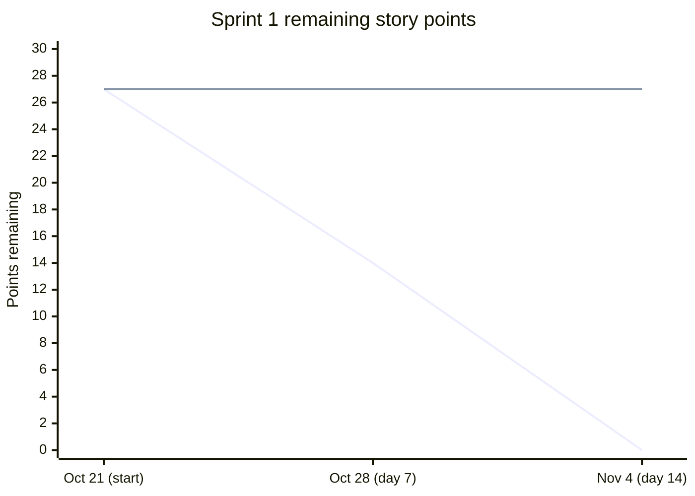

# Kaban Board Sprint 1 Burndown

**Milestone:** [Kaban Board Sprint 1](https://github.com/gaurish109gaur-web/Kaban-Board/milestone/1)  
**Sprint window:** October 21–November 4, 2026  
**Planned scope:** 27 story points across 10 stories

As of October 21, all 10 sprint stories are open and in progress. The measured remaining work is **27 points**; no story points have been completed yet.

The first line is the ideal burn from 27 points to zero. The second line carries the latest observed remaining total forward as a placeholder; only the October 21 value is measured so far. Update it at each daily check-in using **27 minus the points of completed stories**. The chart will show actual progress once stories are completed.
